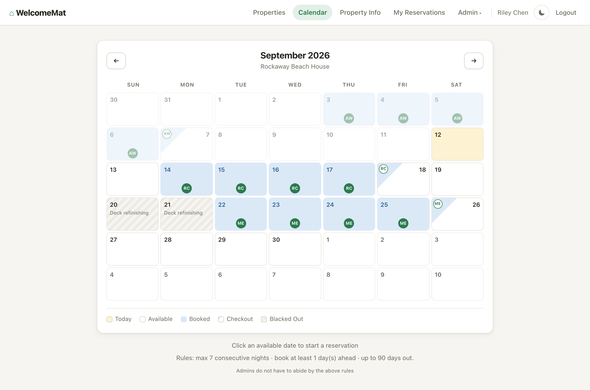
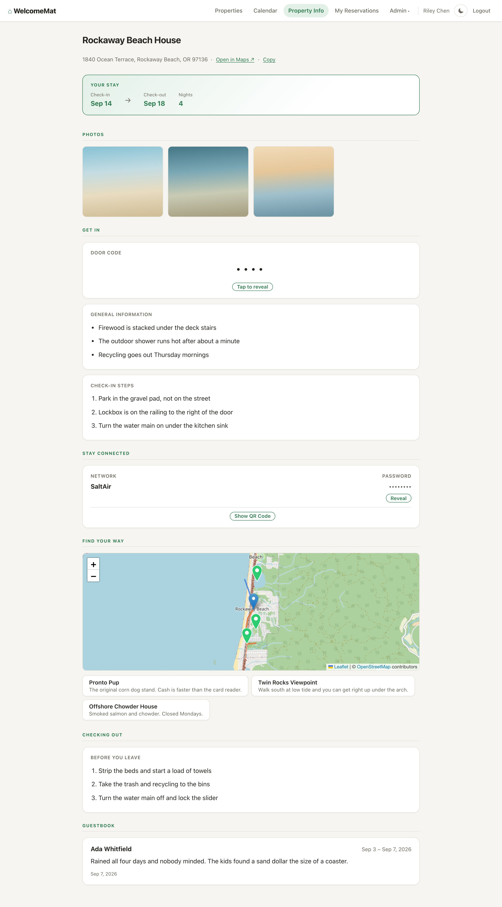
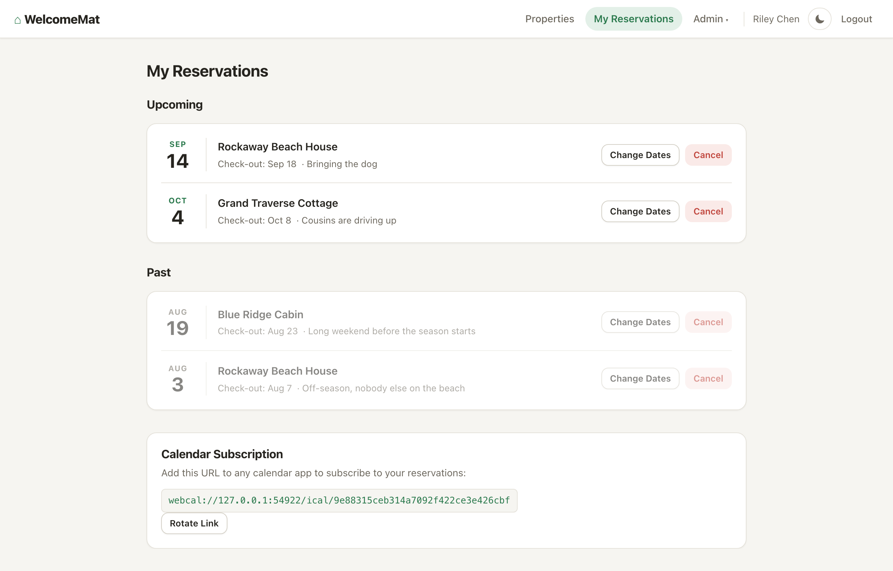
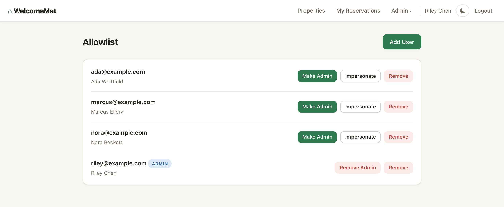

# WelcomeMat

Private reservation system for family & friends.

## Screenshots

Every example guest, address, door code and WiFi password in these shots is invented. The app is running
against demo data, not against my houses.



The calendar is where a reservations is made. Click the day you arrive, click the day you leave. The
booking rules are printed under the grid instead.



Property information in the order of _need_ during a stay: door code, general information, check-in instructions, wifi credentials, places to go, check-out instructions.



Everyone sees their own stays and their own iCalendar feed. That feed URL is a bearer credential:
paste it into a phone calendar, and rotate it from this page if it leaks.



Nobody gets in who isn't on the allowlist. Signing in is Google's job; deciding which Google account
counts is the admin's.

## Tech Stack

- .NET 10 ASP.NET Core (Razor Pages) + [Alpine.js](https://alpinejs.dev)
- SQLite (via Entity Framework Core), single-writer, WAL journaling
- Google OIDC authentication
- [Leaflet](https://leafletjs.com) for maps, tiles from OpenStreetMap
- [Nominatim](https://nominatim.openstreetmap.org) for geocoding (configurable, see below)
- Multi-arch Docker images (amd64 + arm64)

## Getting Started

### Clone and run

```bash
git clone https://github.com/mannkind/welcomemat.git
cd welcomemat

WELCOMEMAT_TEST_AUTH=1 \
ASPNETCORE_ENVIRONMENT=Testing \
GOOGLE_CLIENT_ID=dev GOOGLE_CLIENT_SECRET=dev \
dotnet run --project WelcomeMat
```

The app starts at `http://localhost:8080` in test-auth mode with an empty database; the schema is
created on first run. Seed sample properties, reservations, and users with:

```bash
curl -X POST http://localhost:8080/test-support/reset
```

Then sign in without Google:

- Admin: `http://localhost:8080/test-auth/login?email=admin@test`
- Guest: `http://localhost:8080/test-auth/login?email=guest@test`

> `WELCOMEMAT_TEST_AUTH` exposes unauthenticated `/test-auth` and `/test-support` endpoints, so it
> must never be set in production; the app refuses to start with it set outside
> `ASPNETCORE_ENVIRONMENT=Testing`. See [.env.example](.env.example) for every supported variable.

To start over with a clean database, stop the app and remove its state directory:

```bash
rm -rf WelcomeMat/state
```

### Tests

```bash
dotnet build
dotnet test WelcomeMat.Tests
dotnet test WelcomeMat.E2E -c Release
```

The README images come out of the same harness. That test is marked explicit, so it sits out a
normal run and only fires when you name it:

```bash
dotnet test WelcomeMat.E2E -c Release --filter "FullyQualifiedName~Screenshots"
```

It seeds its own demo data through `/test-support/seed-demo` and writes to `docs/screenshots/`. It
needs a network connection; the property map fetches Leaflet and its tiles from OpenStreetMap.

### Google OIDC

1. Go to the [Google Cloud Console](https://console.cloud.google.com/apis/credentials)
2. Create an OAuth 2.0 Client ID (Web application)
3. Add authorized redirect URI: `https://yourdomain.com/auth/google/callback`
4. Note the Client ID and Client Secret

### Environment variables

Every variable the app reads is listed below and mirrored, as placeholders only, in
[.env.example](.env.example). Variables marked **required** must be set when
`ASPNETCORE_ENVIRONMENT=Production`; the app refuses to start otherwise.

```
BASE_URL=https://yourdomain.com         # required in Production; default: http://localhost:8080
                                         # comma-separated list of absolute HTTP(S) origins if reachable at more than one
GOOGLE_CLIENT_ID=your-client-id         # required in Production
GOOGLE_CLIENT_SECRET=your-client-secret # required in Production
INITIAL_USER=you@example.com            # required to bootstrap the first admin on a brand-new installation; ignored afterward
LISTEN_ADDR=:8080                       # default: :8080
STATE_PATH=./state                      # default: ./state; database, property images, and Data Protection keys all live under here
DATABASE_PATH=./state/reservations.db   # default: <STATE_PATH>/reservations.db
PUSHOVER_TOKEN=                         # optional: comma-separated Pushover application token(s) for admin notifications
PUSHOVER_USER_TOKEN=                    # optional: comma-separated Pushover user/group key(s) to notify
GEOCODING_BASE_URL=                     # optional: override the geocoding provider; default: https://nominatim.openstreetmap.org/
GEOCODING_ENABLED=true                  # default: true; set false to disable outbound geocoding entirely
TRUSTED_PROXIES=                        # optional: comma-separated IP addresses of reverse proxies in front of the app
TRUSTED_NETWORKS=                       # optional: comma-separated CIDR networks of reverse proxies in front of the app
                                         # if both are unset, RFC1918 private space is trusted by default (10.0.0.0/8,
                                         # 172.16.0.0/12, 192.168.0.0/16); set either to restrict trust further
WELCOMEMAT_TEST_AUTH=                   # development/testing only; must never be set in production
```
